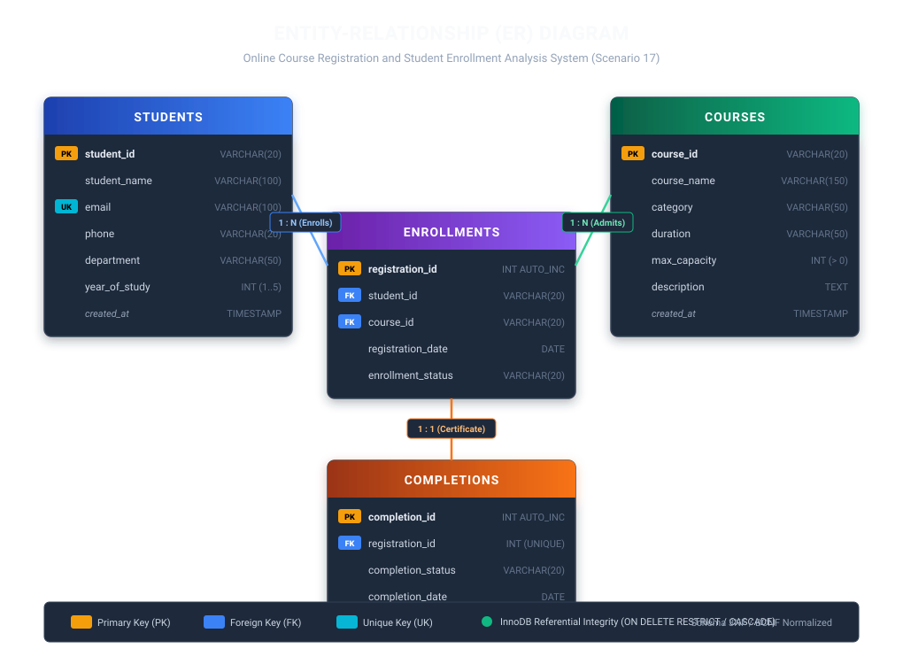

# Part 1: DBMS Module Presentation & Evaluation Guide
**Scenario 17: Online Course Registration and Student Enrollment Analysis System**  
**Register Numbers:** 17, 47, 77, 107 | **Curriculum Regulations:** VCET B.Tech IT R2025  
**Course Code & Title:** 25ITT31 – Database Management Systems  
**Database Technology:** MySQL 8.0+ Enterprise RDBMS (InnoDB Storage Engine)

---

## 1. Objective of the DBMS Module

To design, normalize, and implement a robust relational database schema (`online_course_registration`) that maintains:
1. **Student Master Records** with strict format validation, unique email constraints, and department affiliations.
2. **Course Offerings Catalog** with categorized programs (`Certificate Course`, `Skill Development`, `Technical Training`) and positive seat caps (`max_capacity > 0`).
3. **Transactional Course Enrollments** enforcing ACID atomicity, composite uniqueness (`student_id, course_id`), and status state tracking (`REGISTERED`, `IN_PROGRESS`, `COMPLETED`, `CANCELLED`).
4. **Official Course Completions** linking completed students to verified completion dates and certificate tracking.
5. **Real-time Analytical Views** to monitor live course occupancy percentages and identify top-demanded courses.

---

## 2. Entity-Relationship (ER) Diagram

### 2.1 Visual ER Diagram Architecture
*(Detailed documentation available in [ER_DIAGRAM.md](ER_DIAGRAM.md))*



### 2.2 Crow's Foot Notation (Mermaid Specification)

```mermaid
erDiagram
    STUDENTS ||--o{ ENROLLMENTS : "1:N (registers for)"
    COURSES ||--o{ ENROLLMENTS : "1:N (enrolled in)"
    ENROLLMENTS ||--o| COMPLETIONS : "1:1 (qualifies for certificate)"

    STUDENTS {
        varchar student_id PK "Primary Key (e.g. STU101)"
        varchar student_name "Full Legal Name"
        varchar email UK "Unique Institutional Email"
        varchar phone "Contact Phone (10 digits)"
        varchar department "Academic Department (IT, CSE, AI, ME)"
        int year_of_study "Academic Year (1 to 5)"
        timestamp created_at "Registration Timestamp"
    }

    COURSES {
        varchar course_id PK "Primary Key (e.g. CRS101)"
        varchar course_name "Official Course Title"
        varchar category "Certificate Course | Skill Development | Technical Training"
        varchar duration "Course Duration (e.g. 60 Hours)"
        int max_capacity "Maximum Enrollment Cap (> 0)"
        text description "Syllabus Overview"
        timestamp created_at "Catalog Addition Timestamp"
    }

    ENROLLMENTS {
        int registration_id PK "Primary Key (Auto Increment)"
        varchar student_id FK "References students(student_id)"
        varchar course_id FK "References courses(course_id)"
        date registration_date "Date Enrolled (YYYY-MM-DD)"
        varchar enrollment_status "REGISTERED | IN_PROGRESS | COMPLETED | CANCELLED"
    }

    COMPLETIONS {
        int completion_id PK "Primary Key (Auto Increment)"
        int registration_id FK_UK "References enrollments(registration_id)"
        varchar completion_status "COMPLETED | PENDING | WITHDRAWN"
        date completion_date "Official Completion Date"
    }
```

---

### 2.2 Structural Cardinality & Relationship Breakdown

| Entity 1 | Relationship | Entity 2 | Cardinality | Participation | Business Rule & Structural Rationale |
| :--- | :---: | :--- | :---: | :---: | :--- |
| **`STUDENTS`** | *registers* | **`ENROLLMENTS`** | **1 : N** | Mandatory (1) to Optional (N) | A student can register for multiple distinct courses over semesters. Each enrollment belongs to exactly one student. |
| **`COURSES`** | *offered to* | **`ENROLLMENTS`** | **1 : N** | Mandatory (1) to Optional (N) | A course can admit up to `max_capacity` active students. Each enrollment record maps to one course. |
| **`ENROLLMENTS`** | *completes* | **`COMPLETIONS`** | **1 : 1** | Mandatory (1) to Optional (1) | Each successful enrollment record can generate at most one verified completion certificate entry (`UNIQUE(registration_id)`). |

---

### 2.3 Attributes Classification (For Viva)

* **Primary Keys (Entity Integrity):**
  * `students.student_id`
  * `courses.course_id`
  * `enrollments.registration_id`
  * `completions.completion_id`
* **Candidate / Unique Keys:**
  * `students.email` (Ensures no two student accounts share the same email).
  * `enrollments(student_id, course_id)` (Composite Unique Key: prevents duplicate course registration).
  * `completions.registration_id` (Ensures a student cannot receive multiple certificates for the same enrollment).
* **Foreign Keys (Referential Integrity):**
  * `enrollments.student_id` $\rightarrow$ `students.student_id` (`ON UPDATE CASCADE, ON DELETE RESTRICT`)
  * `enrollments.course_id` $\rightarrow$ `courses.course_id` (`ON UPDATE CASCADE, ON DELETE RESTRICT`)
  * `completions.registration_id` $\rightarrow$ `enrollments.registration_id` (`ON UPDATE CASCADE, ON DELETE CASCADE`)
* **Check Constraints (Domain Integrity):**
  * `students.chk_student_year`: `CHECK (year_of_study BETWEEN 1 AND 5)`
  * `courses.chk_course_capacity`: `CHECK (max_capacity > 0)`
  * `courses.chk_course_category`: `CHECK (category IN ('Certificate Course', 'Skill Development', 'Technical Training'))`
  * `enrollments.chk_enrollment_status`: `CHECK (enrollment_status IN ('REGISTERED', 'IN_PROGRESS', 'COMPLETED', 'CANCELLED'))`
  * `completions.chk_completion_status`: `CHECK (completion_status IN ('COMPLETED', 'PENDING', 'WITHDRAWN'))`

---

## 3. Relational Schema & Normalization (1NF through BCNF)

### 3.1 Functional Dependencies (FDs)
1. **In `students`**:
   $$\text{student\_id} \rightarrow \{\text{student\_name, email, phone, department, year\_of\_study, created\_at}\}$$
   $$\text{email} \rightarrow \{\text{student\_id, student\_name, phone, department, year\_of\_study, created\_at}\}$$
2. **In `courses`**:
   $$\text{course\_id} \rightarrow \{\text{course\_name, category, duration, max\_capacity, description, created\_at}\}$$
3. **In `enrollments`**:
   $$\text{registration\_id} \rightarrow \{\text{student\_id, course\_id, registration\_date, enrollment\_status}\}$$
   $$\{\text{student\_id, course\_id}\} \rightarrow \{\text{registration\_id, registration\_date, enrollment\_status}\}$$
4. **In `completions`**:
   $$\text{completion\_id} \rightarrow \{\text{registration\_id, completion\_status, completion\_date}\}$$
   $$\text{registration\_id} \rightarrow \{\text{completion\_id, completion\_status, completion\_date}\}$$

### 3.2 Step-by-Step Normalization Proof

* **First Normal Form (1NF)**:
  * All attribute values are atomic (indivisible scalars). Multi-valued phone numbers or comma-separated course lists are strictly disallowed.
* **Second Normal Form (2NF)**:
  * The schema is in 1NF and contains **no partial functional dependencies**. Every non-prime attribute is fully functionally dependent on the entire primary key.
* **Third Normal Form (3NF)**:
  * The schema is in 2NF and contains **no transitive functional dependencies** ($X \rightarrow Y$ and $Y \rightarrow Z$ where $Z$ is non-prime). Course attributes (e.g., duration, category) are stored strictly in `courses`, not repeated in `enrollments`.
* **Boyce-Codd Normal Form (BCNF)**:
  * For every non-trivial functional dependency $X \rightarrow Y$, the determinant $X$ is a superkey or candidate key. All four relations satisfy BCNF.

---

## 4. Key Database Views

### 4.1 Course Enrollment & Seat Availability Summary View
```sql
CREATE OR REPLACE VIEW vw_course_enrollment_summary AS
SELECT 
    c.course_id,
    c.course_name,
    c.category,
    c.duration,
    c.max_capacity,
    COUNT(CASE WHEN e.enrollment_status != 'CANCELLED' THEN e.registration_id END) AS active_enrollments,
    (c.max_capacity - COUNT(CASE WHEN e.enrollment_status != 'CANCELLED' THEN e.registration_id END)) AS available_seats,
    ROUND(
        (COUNT(CASE WHEN e.enrollment_status != 'CANCELLED' THEN e.registration_id END) * 100.0) / c.max_capacity, 
        2
    ) AS occupancy_percentage
FROM courses c
LEFT JOIN enrollments e ON c.course_id = e.course_id
GROUP BY c.course_id, c.course_name, c.category, c.duration, c.max_capacity;
```

### 4.2 Top Popular Courses View
```sql
CREATE OR REPLACE VIEW vw_popular_courses AS
SELECT 
    c.course_id,
    c.course_name,
    c.category,
    COUNT(e.registration_id) AS total_enrolled,
    RANK() OVER (ORDER BY COUNT(e.registration_id) DESC) AS popularity_rank
FROM courses c
JOIN enrollments e ON c.course_id = e.course_id
WHERE e.enrollment_status != 'CANCELLED'
GROUP BY c.course_id, c.course_name, c.category;
```

---

## 5. ACID Transaction & Concurrency Control

### Transactional Enrollment Workflow
```sql
START TRANSACTION;

-- 1. Lock the course record to serialize concurrent seat evaluations
SELECT max_capacity FROM courses WHERE course_id = 'CRS101' FOR UPDATE;

-- 2. Count active non-cancelled seats
SELECT COUNT(*) INTO @enrolled FROM enrollments 
WHERE course_id = 'CRS101' AND enrollment_status != 'CANCELLED';

-- 3. Check condition: If seats available, insert; else abort
INSERT INTO enrollments (student_id, course_id, registration_date, enrollment_status)
VALUES ('STU108', 'CRS101', CURDATE(), 'REGISTERED');

COMMIT;
```

---

## 6. Viva Questions & Model Answers

**Q1: How does your database prevent a student from registering twice for the same course?**  
> *Answer*: Through a dual-layer defense. At the database level, the `enrollments` table enforces a composite unique constraint `CONSTRAINT uk_student_course UNIQUE (student_id, course_id)`. At the application level, `EnrollmentDAO.isStudentRegistered()` executes a pre-check query before attempting an insert.

**Q2: What happens to available seats when a student cancels their registration?**  
> *Answer*: The status is set to `'CANCELLED'`. Active seat calculations use `COUNT(CASE WHEN enrollment_status != 'CANCELLED' THEN ... END)`, so cancelled records immediately restore vacancy without deleting audit history.

**Q3: Why use InnoDB over MyISAM?**  
> *Answer*: InnoDB supports foreign key referential integrity, ACID transactional commits/rollbacks (`SET autocommit = 0`), and row-level locking (`FOR UPDATE`) essential for preventing race conditions in course registrations.
