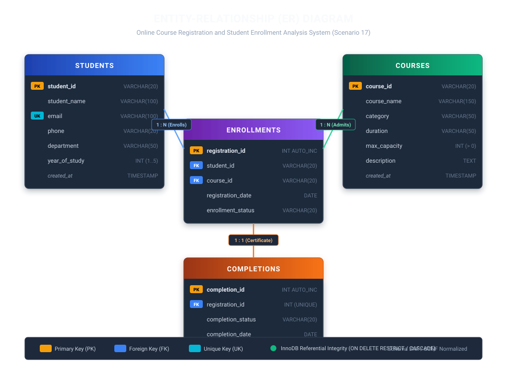

# Entity-Relationship (ER) Diagram & Relational Model Guide
**Scenario 17: Online Course Registration and Student Enrollment Analysis System**  
**Register Numbers:** 17, 47, 77, 107 | **Curriculum Regulations:** VCET B.Tech IT R2025  
**Course Code & Title:** 25ITT31 – Database Management Systems (Unit 1: ER Model & Relational Design)

---

## 1. Visual Entity-Relationship Diagram

### High-Resolution Architectural Diagram
The full relational visual architecture is illustrated below:



---

## 2. Crow's Foot Notation (Mermaid Specification)

```mermaid
erDiagram
    STUDENTS ||--o{ ENROLLMENTS : "1:N (Registers for)"
    COURSES ||--o{ ENROLLMENTS : "1:N (Admits / Offered to)"
    ENROLLMENTS ||--o| COMPLETIONS : "1:1 (Qualifies for Certificate)"

    STUDENTS {
        varchar student_id PK "Primary Key (e.g., STU101)"
        varchar student_name "Student Full Legal Name"
        varchar email UK "Unique Institutional Email"
        varchar phone "10-Digit Contact Number"
        varchar department "Academic Dept (IT, CSE, AI, ME)"
        int year_of_study "Academic Year (1 to 5)"
        timestamp created_at "Account Registration Timestamp"
    }

    COURSES {
        varchar course_id PK "Primary Key (e.g., CRS101)"
        varchar course_name "Course Title"
        varchar category "Certificate Course | Skill Dev | Tech Training"
        varchar duration "Course Duration (e.g., 60 Hours)"
        int max_capacity "Maximum Enrollment Cap (> 0)"
        text description "Detailed Course Outline"
        timestamp created_at "Catalog Entry Timestamp"
    }

    ENROLLMENTS {
        int registration_id PK "Primary Key (Auto Increment)"
        varchar student_id FK "References students(student_id)"
        varchar course_id FK "References courses(course_id)"
        date registration_date "Enrollment Date (YYYY-MM-DD)"
        varchar enrollment_status "REGISTERED | IN_PROGRESS | COMPLETED | CANCELLED"
    }

    COMPLETIONS {
        int completion_id PK "Primary Key (Auto Increment)"
        int registration_id FK_UK "References enrollments(registration_id) [1:1]"
        varchar completion_status "COMPLETED | PENDING | WITHDRAWN"
        date completion_date "Official Completion Date"
    }
```

---

## 3. Classical Chen's Notation Decomposition

In Chen's Notation for DBMS academic viva:
- **Entities (Rectangles)**: `STUDENTS`, `COURSES`, `ENROLLMENTS` (Associative Entity), `COMPLETIONS`.
- **Attributes (Ellipses)**:
  - *Primary Key Attributes (Underlined)*: <u>`student_id`</u>, <u>`course_id`</u>, <u>`registration_id`</u>, <u>`completion_id`</u>.
  - *Candidate/Unique Attributes*: `email` in `STUDENTS`, composite `(student_id, course_id)` in `ENROLLMENTS`.
  - *Derived Attributes (Dashed Ellipses)*: `available_seats` (= `max_capacity - active_enrollments`), `occupancy_percentage`.
  - *Single-Valued Attributes*: `student_name`, `phone`, `department`, `duration`, `registration_date`.
- **Relationship Sets (Diamonds)**:
  - `REGISTERS`: Binary relationship between `STUDENTS` and `ENROLLMENTS` with cardinality ratio **1 : N**.
  - `OFFERS / ADMITS`: Binary relationship between `COURSES` and `ENROLLMENTS` with cardinality ratio **1 : N**.
  - `CERTIFIES`: Binary relationship between `ENROLLMENTS` and `COMPLETIONS` with cardinality ratio **1 : 1**.

---

## 4. Cardinality Ratios & Participation Constraints

| Entity Pair | Relationship Set | Cardinality Ratio | Participation Constraint | Business Rule Justification |
| :--- | :---: | :---: | :---: | :--- |
| **`STUDENTS` $\rightarrow$ `ENROLLMENTS`** | *Registers* | **1 : N** | Optional (0) to Mandatory (1) | A student may register for zero, one, or multiple courses ($0 \dots N$). An enrollment record must belong to exactly one student ($1 \dots 1$). |
| **`COURSES` $\rightarrow$ `ENROLLMENTS`** | *Admits* | **1 : N** | Optional (0) to Mandatory (1) | A course can have zero enrollments initially and up to `max_capacity` students ($0 \dots C$). Every enrollment record references exactly one course ($1 \dots 1$). |
| **`ENROLLMENTS` $\rightarrow$ `COMPLETIONS`** | *Certifies* | **1 : 1** | Optional (0) to Mandatory (1) | An active enrollment initially has no completion record ($0 \dots 1$). Once completed, exactly one certificate record is created (`UNIQUE(registration_id)`). |

---

## 5. ER to Relational Schema Mapping Steps

The conceptual ER model maps directly into the relational schema following standard textbook conversion rules:

1. **Strong Entity Sets**:
   - `STUDENTS(student_id, student_name, email, phone, department, year_of_study, created_at)`
   - `COURSES(course_id, course_name, category, duration, max_capacity, description, created_at)`
2. **Binary 1:N Relationships**:
   - The primary key of the "1" side is placed into the "N" side table as a Foreign Key.
   - `student_id` and `course_id` are imported into `ENROLLMENTS`.
   - `ENROLLMENTS(registration_id, student_id, course_id, registration_date, enrollment_status)`
   - `CONSTRAINT uk_student_course UNIQUE (student_id, course_id)` prevents multi-enrollment anomalies.
3. **Binary 1:1 Relationships**:
   - Primary key of `ENROLLMENTS` (`registration_id`) is imported into `COMPLETIONS` with a `UNIQUE` constraint to maintain 1:1 cardinality.
   - `COMPLETIONS(completion_id, registration_id, completion_status, completion_date)`

---

## 6. Normalization Proofs (1NF to BCNF)

* **1NF (Atomicity)**: All attributes contain strictly atomic, non-composite, single values.
* **2NF (No Partial Dependency)**: Every non-prime attribute depends on the full candidate key. No subset of candidate keys determines non-prime attributes.
* **3NF (No Transitive Dependency)**: In every relation, if $X \rightarrow Y$, then either $X$ is a superkey or $Y$ is a prime attribute.
* **BCNF (Boyce-Codd Normal Form)**: For every non-trivial functional dependency $X \rightarrow Y$, $X$ is strictly a superkey. Eliminates all update, deletion, and insertion anomalies.

---

## 7. ER Diagram Viva Questions & Model Answers

**Q1: Why is `ENROLLMENTS` modeled as an entity rather than a simple M:N relationship table?**  
> *Answer*: In course management, a registration has its own lifecycle attributes (`registration_date`, `enrollment_status`) and serves as the parent entity for course completions (`COMPLETIONS`). Promoting it to an associative entity with a surrogate primary key (`registration_id`) provides cleaner indexing and simplifies foreign key references.

**Q2: How does the ER model handle student registration cancellation?**  
> *Answer*: Rather than executing a hard `DELETE` that would destroy institutional audit history, the relationship state changes to `enrollment_status = 'CANCELLED'`. SQL views and queries compute available capacity dynamically by filtering `enrollment_status != 'CANCELLED'`.

**Q3: How is duplicate enrollment prevented structurally in the schema?**  
> *Answer*: Through a composite unique constraint `UNIQUE (student_id, course_id)` on the `ENROLLMENTS` table, ensuring that the database engine rejects any attempt by a student to register twice for the same course offering.
