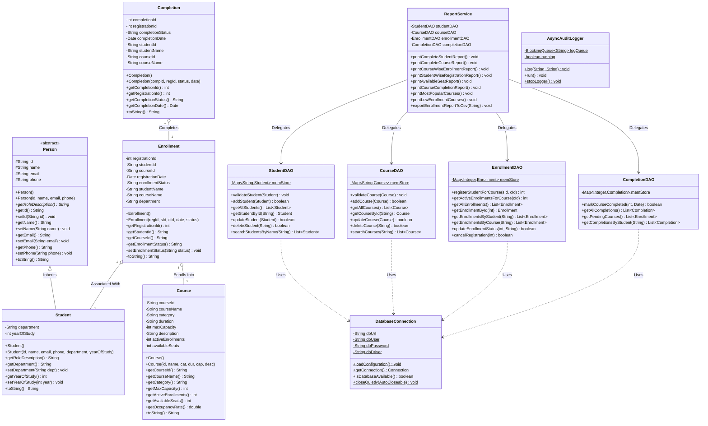

# CLASS-BASED MODELING & CLASS DIAGRAM
## Online Course Registration and Student Enrollment Analysis System
**Academic Scenario 17** | Curriculum Reference: 25ITT32 Java Programming & 25ITT33 Software Engineering

---

## 1. UML CLASS DIAGRAM

---

## 2. SYLLABUS CONCEPT MAPPINGS

1. **Inheritance & Polymorphism (Java Unit 2)**:
   - `Person` defines common state and behaviour (`id`, `name`, `email`, `phone`).
   - `Student` extends `Person`, invoking `super(...)` and overriding `getRoleDescription()`. Dynamic method dispatch occurs when polymorphic references invoke overridden methods.
2. **Encapsulation & Constructors (Java Unit 1)**:
   - Private attributes with getter/setter accessors.
   - Parameterized and default constructors for entity initialization.
3. **Exception Handling Hierarchy (Java Unit 3)**:
   - `CustomExceptions.CourseFullException`
   - `CustomExceptions.DuplicateRegistrationException`
   - `CustomExceptions.ValidationException`
   - `CustomExceptions.RecordNotFoundException`
4. **Collections, Generics & Lambdas (Java Unit 5)**:
   - Collections: `List<Student>`, `List<Course>`, `Map<String, Course>`.
   - Lambdas and Streams: Filter, sort, and map operations: e.g. `list.stream().filter(e -> ...).sorted(...).collect(Collectors.toList())`.
5. **Multithreaded Background Processing (Java Unit 3)**:
   - `AsyncAuditLogger` implements `Runnable` and runs as a daemon thread executing concurrent log persistence without blocking main UI threads.
