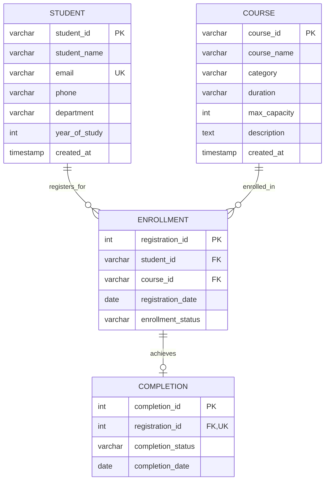

# ENTITY-RELATIONSHIP (ER) MODEL & DATABASE DESIGN
## Online Course Registration and Student Enrollment Analysis System
**Academic Scenario 17** | Curriculum Reference: 25ITT31 DBMS (Unit 1: Design & Unit 3: Normalization)

---

## 1. ER DIAGRAM (CROW'S FOOT NOTATION)

The ER diagram captures institutional entities, their attributes, keys, and relational mapping cardinalities.

---

## 2. ENTITIES, ATTRIBUTES, AND CARDINALITIES

### 2.1 Mapping Cardinalities
1. **STUDENT to ENROLLMENT (1 : N)**:
   - A single student can enroll in zero, one, or multiple courses ($0 \dots N$).
   - An enrollment record must belong to exactly one registered student ($1 \dots 1$).
2. **COURSE to ENROLLMENT (1 : N)**:
   - A single course can accommodate up to `max_capacity` student enrollments ($0 \dots \text{max\_capacity}$).
   - Each enrollment record references exactly one course ($1 \dots 1$).
3. **ENROLLMENT to COMPLETION (1 : 1 optional)**:
   - An enrollment may have zero or one completion certificate ($0 \dots 1$).
   - A completion certificate must map to exactly one valid enrollment ($1 \dots 1$).

### 2.2 Relational Integrity Constraints
- **Primary Keys**: `students.student_id`, `courses.course_id`, `enrollments.registration_id`, `completions.completion_id`.
- **Foreign Keys**:
  - `enrollments.student_id` $\rightarrow$ `students.student_id` (ON UPDATE CASCADE, ON DELETE RESTRICT)
  - `enrollments.course_id` $\rightarrow$ `courses.course_id` (ON UPDATE CASCADE, ON DELETE RESTRICT)
  - `completions.registration_id` $\rightarrow$ `enrollments.registration_id` (ON UPDATE CASCADE, ON DELETE CASCADE)
- **Unique Constraints**:
  - `students.email` (UNIQUE)
  - `enrollments(student_id, course_id)` (COMPOSITE UNIQUE - Prevents duplicate registrations)
  - `completions.registration_id` (UNIQUE - Prevents duplicate completion records)
- **Check Constraints**:
  - `students.year_of_study BETWEEN 1 AND 5`
  - `courses.max_capacity > 0`
  - `courses.category IN ('Certificate Course', 'Skill Development', 'Technical Training')`
  - `enrollments.enrollment_status IN ('REGISTERED', 'IN_PROGRESS', 'COMPLETED', 'CANCELLED')`
  - `completions.completion_status IN ('COMPLETED', 'PENDING', 'WITHDRAWN')`

---

## 3. DATABASE NORMALIZATION ANALYSIS

The relational schema was designed following formal normalization theory:

### 3.1 First Normal Form (1NF)
- All attribute domains contain strictly **atomic values** (no multi-valued attributes, no repeating groups).
- Each table possesses a designated Primary Key.

### 3.2 Second Normal Form (2NF)
- The relations are in 1NF.
- There are **no partial dependencies**: every non-prime attribute is fully functionally dependent on the entire primary key. In `enrollments`, the surrogate primary key `registration_id` determines all attributes, and composite candidate key $(student\_id, course\_id)$ strictly determines registration status and date without partial attributes.

### 3.3 Third Normal Form (3NF)
- The relations are in 2NF.
- There are **no transitive dependencies** ($X \rightarrow Y$ and $Y \rightarrow Z$).
- Course details (e.g. `course_name`, `max_capacity`) are isolated in `courses`, not duplicated inside `enrollments`. Student details (e.g. `student_name`, `department`) are isolated in `students`. Derived quantities such as available seats are computed dynamically via SQL Views or joins rather than stored as redundant mutable columns.

### 3.4 Boyce-Codd Normal Form (BCNF)
- For every non-trivial functional dependency $X \rightarrow Y$, $X$ is a superkey.
- Thus, the relational schema is in **BCNF**, completely free from insertion, update, and deletion anomalies.
