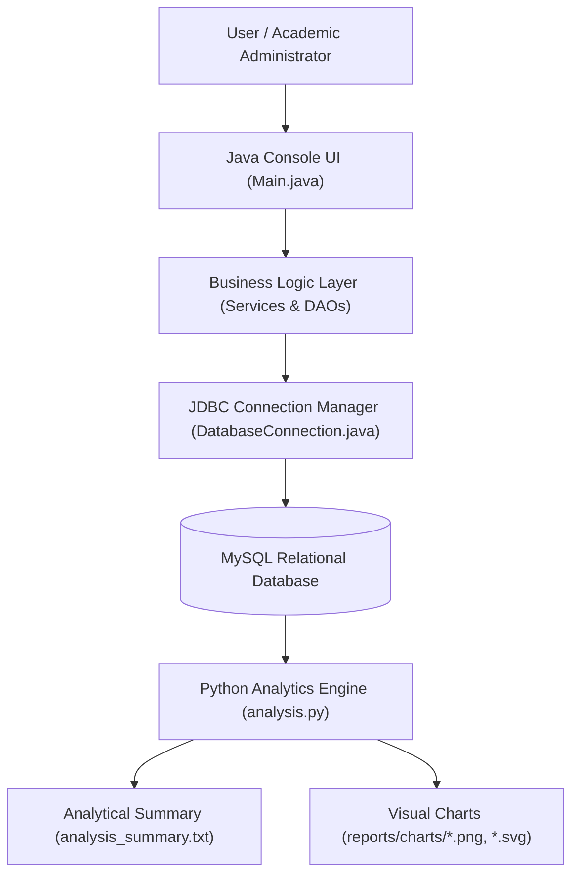

# SOFTWARE REQUIREMENTS SPECIFICATION (SRS)
## Online Course Registration and Student Enrollment Analysis System
**Academic Scenario 17** (Register Numbers: 17, 47, 77, 107)  
**Curriculum Reference**: VCET B.Tech IT R2025 | 25ITT33 Software Engineering (Unit 2: Requirements)

---

## 1. INTRODUCTION

### 1.1 Purpose
This Software Requirements Specification (SRS) document defines the complete functional and non-functional requirements for the **Online Course Registration and Student Enrollment Analysis System**. It outlines the operational capabilities, architectural boundaries, validation constraints, and interface specifications for students, academic administrators, and institutional analysts.

### 1.2 Scope of the Project
The educational institution offers diverse certificate courses, skill development programs, and technical training sessions across engineering departments. The software manages the complete lifecycle of course registration, seat quota enforcement, enrollment status tracking, and course completion verification, combined with statistical data science analytics and exploratory visualization of enrollment trends.

### 1.3 Definitions, Acronyms, and Abbreviations
- **SRS**: Software Requirements Specification
- **DBMS**: Database Management System (MySQL)
- **JDBC**: Java Database Connectivity
- **DAO**: Data Access Object
- **ACID**: Atomicity, Consistency, Isolation, Durability
- **EDA**: Exploratory Data Analysis
- **DFD**: Data Flow Diagram
- **ERD**: Entity-Relationship Diagram

### 1.4 References
1. Roger S. Pressman & Bruce R. Maxim, *Software Engineering: A Practitioner’s Approach*, 9th Edition, McGraw-Hill, 2020.
2. Ian Sommerville, *Software Engineering*, 10th Edition, Pearson, 2023.
3. Abraham Silberschatz, Henry F. Korth, S. Sudarshan, *Database System Concepts*, 7th Edition, McGraw-Hill, 2020.
4. Herbert Schildt, *Java: The Complete Reference*, 13th Edition, McGraw-Hill, 2024.
5. Wes McKinney, *Python for Data Analysis*, 3rd Edition, O'Reilly Media, 2022.

---

## 2. OVERALL DESCRIPTION

### 2.1 Existing System vs. Proposed System

| Dimension | Existing Manual / Spreadsheet System | Proposed Automated System |
| :--- | :--- | :--- |
| **Registration Processing** | Manual paper forms or disconnected spreadsheets. | Centralized console application with JDBC database persistence. |
| **Capacity Enforcement** | Delay in updating counts causes chronic over-enrollment. | Immediate ACID transactional check prevents exceeding course capacity. |
| **Duplicate Prevention** | High human error leading to duplicate registrations. | Dual-layer validation: Java logic check + MySQL composite UNIQUE constraint. |
| **Cancellation Handling** | Cancelled students still occupy seats on paper records. | Dynamic seat calculation (`status != 'CANCELLED'`) immediately restores seats. |
| **Completion Tracking** | Manual issuance of certificates without cross-checks. | Relational integrity link (`completions -> enrollments`) prevents invalid certificates. |
| **Institutional Analytics** | Manual tallying taking weeks to find popular courses. | Automated Python Data Science module (Pandas, NumPy, Matplotlib, Seaborn). |

### 2.2 Product Perspective & Architectural Tiering
The system adopts an extensible 3-Tier Layered Architecture:
1. **Presentation Layer**: Interactive Java Console Menu Interface providing structured input forms, tabular record listings, and confirmation dialogs.
2. **Business Logic & Persistence Layer**: Object-Oriented Domain Entities (`Student`, `Course`, `Enrollment`, `Completion`), specialized DAOs, and JDBC connectivity executing ACID transactions.
3. **Database & Analytical Layer**: Normalized MySQL database (`online_course_registration`), database views, and a dedicated Python analytics engine.

---

## 3. FUNCTIONAL REQUIREMENTS

### FR-1: Student Management
- **FR-1.1**: The system shall register a new student with Student ID, Name, Email, Phone, Department, and Year of Study (1-5).
- **FR-1.2**: The system shall enforce that Student ID is unique across all records.
- **FR-1.3**: The system shall validate email address format (`^[A-Za-z0-9+_.-]+@[A-Za-z0-9.-]+\.[A-Za-z]{2,}$`).
- **FR-1.4**: The system shall allow searching, updating, and viewing student profiles.
- **FR-1.5**: The system shall reject student deletion if active course enrollments exist.

### FR-2: Course Management
- **FR-2.1**: The system shall allow administrators to create courses with Course ID, Course Name, Category, Duration, Maximum Capacity (> 0), and Description.
- **FR-2.2**: The system shall restrict categories to: `Certificate Course`, `Skill Development`, and `Technical Training`.
- **FR-2.3**: The system shall calculate live active enrollments and available seats for every course.
- **FR-2.4**: The system shall reject course deletion if active student registrations exist.

### FR-3: Course Registration & Transaction Management
- **FR-3.1**: The system shall allow valid students to register for active courses.
- **FR-3.2**: The system shall verify that the Student ID and Course ID exist before initiating registration.
- **FR-3.3**: The system shall check whether the student has already registered for the selected course and reject duplicates.
- **FR-3.4**: The system shall verify available seat capacity within a database transaction (`setAutoCommit(false)`).
- **FR-3.5**: If available seats > 0, registration shall be confirmed with status `REGISTERED` and committed.
- **FR-3.6**: If the course is full, the transaction shall rollback and throw `CourseFullException`.

### FR-4: Enrollment Status & Cancellation Management
- **FR-4.1**: The system shall track enrollment status: `REGISTERED`, `IN_PROGRESS`, `COMPLETED`, `CANCELLED`.
- **FR-4.2**: The system shall allow cancellation of registrations, requiring user confirmation.
- **FR-4.3**: Cancelled registrations shall immediately release course capacity.

### FR-5: Course Completion Management
- **FR-5.1**: The system shall allow administrators to mark active enrollments as `COMPLETED`.
- **FR-5.2**: The system shall atomically update enrollment status and record a certificate entry into the `completions` table.
- **FR-5.3**: The system shall prevent marking `CANCELLED` registrations as completed.

### FR-6: Reporting & SQL Analytics
- **FR-6.1**: The system shall generate tabular reports for Student Details, Course Offerings, Available Seats, Course-wise Enrollments, Student-wise Enrollments, and Completions.
- **FR-6.2**: The system shall identify the most popular courses (ranked descending by enrollment count).
- **FR-6.3**: The system shall identify low-enrollment courses (occupancy < 50% capacity).
- **FR-6.4**: The system shall export consolidated enrollment records to CSV.

### FR-7: Python Data Science & Visualizations
- **FR-7.1**: The Python module shall connect directly to MySQL via `mysql-connector-python` or read the verified database snapshot CSV.
- **FR-7.2**: The Python module shall compute 5 core statistical analyses using Pandas and NumPy.
- **FR-7.3**: The system shall generate 6 visual charts:
  1. Course-wise Enrollment Bar Chart
  2. Course Category Distribution Pie Chart
  3. Top 5 Popular Courses Bar Chart
  4. Available Seats per Course Horizontal Bar Chart
  5. Completed vs. Pending Enrollments Pie Chart
  6. Student-Course Cross-Tabulation Heatmap Matrix

---

## 4. NON-FUNCTIONAL REQUIREMENTS

1. **Data Integrity & Consistency**: Enforced via relational Primary Keys, Foreign Keys, NOT NULL, CHECK constraints, and unique composite keys.
2. **Transaction Isolation & ACID Compliance**: Enforces atomic commit and rollback to prevent over-enrollment under concurrent requests.
3. **Robustness & Exception Handling**: Custom checked exceptions (`CourseFullException`, `DuplicateRegistrationException`, `ValidationException`, `RecordNotFoundException`) prevent crashes and provide clear user messages.
4. **Security & Credential Externalization**: Database credentials are kept in `db.properties` or environment variables; no passwords hardcoded in source code.
5. **Portability & Syllabus Compliance**: Runs on standard Java 21 / 17 SE, MySQL 8.0, and standard Python 3.10+ without heavy external web frameworks.
