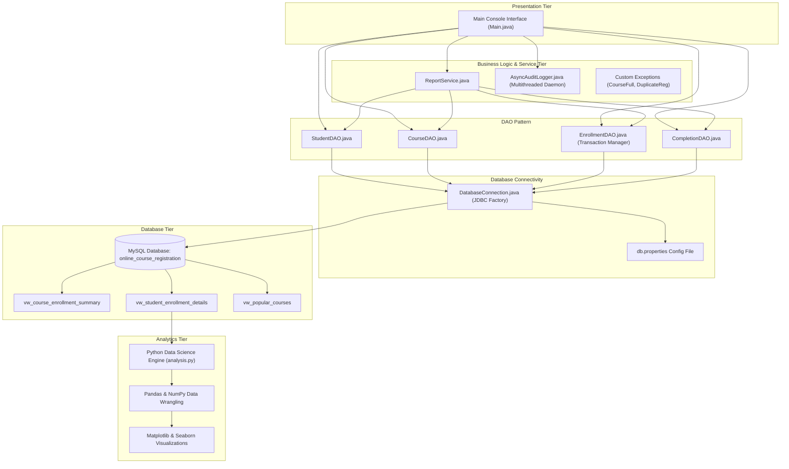
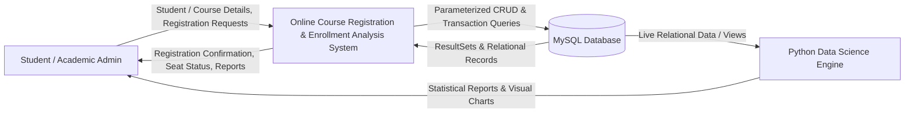
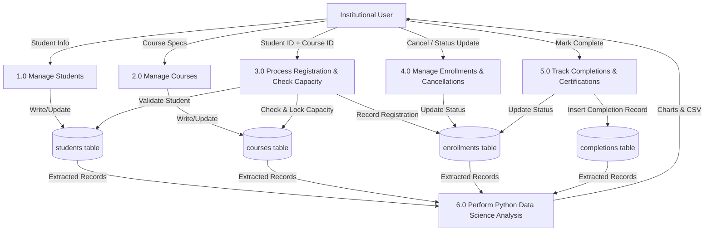

# SYSTEM DESIGN & ARCHITECTURE DOCUMENT
## Online Course Registration and Student Enrollment Analysis System
**Academic Scenario 17** | Curriculum Reference: 25ITT33 Software Engineering (Unit 3: Design)

---

## 1. ARCHITECTURAL DESIGN & PATTERNS

The application follows the classic **Layered Architecture Style** and **Data Access Object (DAO) Pattern**, separating user interface, domain logic, data persistence, and data science analysis into decoupled tiers.



---

## 2. DATA FLOW DIAGRAMS (DFD)

### 2.1 Level 0: Context Analysis Diagram
The Context Diagram defines the external entity interactions with the core system boundary.



### 2.2 Level 1: System Decomposition DFD
Breaks down the system into its 5 primary functional processes:



---

## 3. ALGORITHMS AND WORKFLOWS

### 3.1 Course Registration Algorithm (Transaction Management)
This algorithm prevents over-enrollment and duplicate registrations using ACID transactions as covered in DBMS Unit 4.

```text
ALGORITHM: RegisterStudentForCourse(student_id, course_id)
INPUT: student_id (VARCHAR), course_id (VARCHAR)
OUTPUT: registration_id (INT) or Exception

1. Verify student exists in 'students' table.
   IF not found THEN THROW RecordNotFoundException("Student does not exist").

2. Verify course exists in 'courses' table.
   IF not found THEN THROW RecordNotFoundException("Course does not exist").

3. BEGIN TRANSACTION:
   Set connection.setAutoCommit(false).

4. Check duplicate registration:
   SELECT COUNT(*) FROM enrollments WHERE student_id = ? AND course_id = ?;
   IF count > 0 THEN
      ROLLBACK TRANSACTION;
      THROW DuplicateRegistrationException("Student already registered for this course").

5. Lock and evaluate course capacity:
   SELECT max_capacity FROM courses WHERE course_id = ? FOR UPDATE;
   SELECT COUNT(*) FROM enrollments WHERE course_id = ? AND enrollment_status != 'CANCELLED';
   
   IF active_count >= max_capacity THEN
      ROLLBACK TRANSACTION;
      THROW CourseFullException("Course is full. Available seats: 0").

6. Insert registration record:
   INSERT INTO enrollments (student_id, course_id, registration_date, enrollment_status)
   VALUES (student_id, course_id, CURRENT_DATE, 'REGISTERED');
   Retrieve generated registration_id.

7. COMMIT TRANSACTION:
   connection.commit();
   connection.setAutoCommit(true);

8. Log action asynchronously to audit trail.
9. RETURN registration_id.
```

### 3.2 Seat Availability Calculation Formula
$$\text{Available Seats} = \max\left(0, \text{max\_capacity} - \sum_{\text{status} \neq \text{'CANCELLED'}} 1\right)$$

$$\text{Occupancy Rate (\%)} = \left(\frac{\text{Active Enrollments}}{\text{max\_capacity}}\right) \times 100$$
